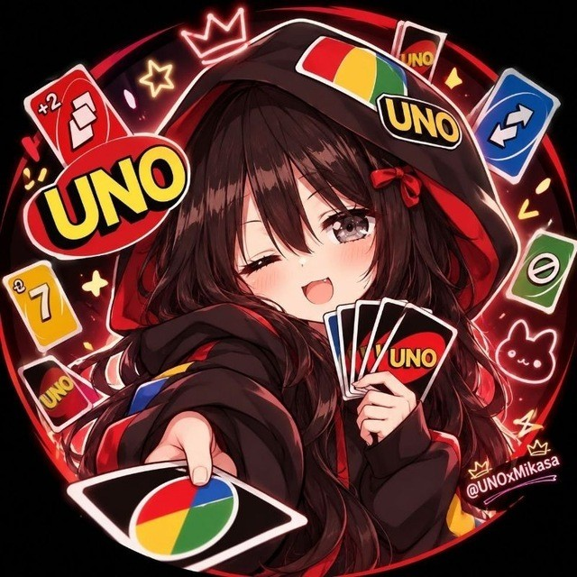

<div align="center">




#### 𝕸𝖎𝖐𝖆𝖘𝖆 𝖀𝖓𝖔


[](https://t.me/Ig_MikasaBot)
[](https://t.me/Ig_MikasaBot?startgroup=true)


</div>

---

## 🃏 About

Mikasa UNO is a Telegram bot that lets you play UNO in group chats. Games run through inline mode, so anyone in the group can join a table and play their cards without leaving the chat. Based on [jh0ker/mau_mau_bot](https://github.com/jh0ker/mau_mau_bot).

All messages are shown in ꜱᴍᴀʟʟ ᴄᴀᴘꜱ by default (switch off with `SMALL_CAPS=false`).

## ✨ Features

- **Plays in group chats.** Add the bot to a group and start a table.
- **Inline play.** Type `@Ig_MikasaBot` to pick your cards from the chat.
- **Three game modes.** `classic`, `fast` and `wild`, set with `DEFAULT_GAMEMODE` and explained by `/modes`.
- **Stats.** `/stats` keeps your record in SQLite.
- **Admin control.** Set `ADMIN_LIST` to let specific users manage every game.
- **Sleeps when idle.** On Render the bot uses Telegram webhooks, so a message wakes the free instance and it sleeps again after 15 minutes without incoming requests. The bot never pings itself.

## 🚀 Setup with @BotFather

1. `/newbot` and copy the **token**.
2. `/setinline` and choose a placeholder, for example `Pick a card`.
3. `/setinlinefeedback` and choose **Enabled** (100%).

Steps 2 and 3 are required because the game is played through inline mode. The command menu is set automatically by the bot.

## ☁️ Deploy on Render

Upload these files to a GitHub repository (`render.yaml` must be in the root).

**Option A: one click (Blueprint)**

Render dashboard → **New** → **Blueprint** → pick your repo → paste your `TELEGRAM_BOT_TOKEN` → **Apply**.

**Option B: manual Web Service**

| Setting | Value |
| --- | --- |
| Runtime | `Python 3` |
| Build Command | `pip install -r requirements.txt` |
| Start Command | `python bot.py` |
| Instance Type | `Free` |

Add these environment variables:

| Key | Value |
| --- | --- |
| `TELEGRAM_BOT_TOKEN` | your bot token (`TOKEN` also works) |
| `PYTHON_VERSION` | `3.11.9` |

> `PYTHON_VERSION` matters: new Render services default to Python 3.14, and `python-telegram-bot` 13.x does not run on 3.12 or newer, so keep Python at 3.11. The repo also has a `.python-version` file as a second safeguard.

When the logs show `Command menu set`, open **[@Ig_MikasaBot](https://t.me/Ig_MikasaBot)** and send `/start`.

### Free plan notes

- Render sleeps free web services after 15 minutes without incoming requests. The bot does not ping itself, so it costs no instance hours while idle. The first message after a sleep can take up to a minute to answer while the instance starts.
- An external monitor (such as UptimeRobot) that calls `/health` every few minutes keeps the instance awake all the time and uses up your free hours. Turn it on only when you want the bot awake, and pause it to let the bot sleep.
- Games are kept in memory. If the instance sleeps during a game, that game is lost. Do **not** add an external uptime monitor (such as UptimeRobot) for `/health`, since it keeps the instance awake and uses up your hours.
- The free filesystem resets on every redeploy, so `/stats` data (stored in SQLite) resets too. Games live in memory anyway.

## ⚙️ Settings

| Variable | Default | What it does |
| --- | --- | --- |
| `TELEGRAM_BOT_TOKEN` | required | Bot token from @BotFather (`TOKEN` also works) |
| `ADMIN_LIST` | none | Telegram user IDs (spaces or commas) who can manage every game |
| `SMALL_CAPS` | `true` | ꜱᴍᴀʟʟ ᴄᴀᴘꜱ text on or off |
| `DEFAULT_GAMEMODE` | `fast` | `classic`, `fast` or `wild` |
| `WAITING_TIME` | `120` | Seconds a player has per turn |
| `MIN_PLAYERS` | `2` | Players needed to start |
| `OPEN_LOBBY` | `true` | Whether new players can join a running game |
| `WEBHOOK_URL` | Render's `RENDER_EXTERNAL_URL` | Public URL Telegram sends updates to. Unset (local runs) uses long polling |
| `DEV_CONTACT_URL` | `https://t.me/Sexiest_Banda` | Link behind the Dev button in `/about` |

`config.json` (see `config.json.example`) still works for local runs.

## 🧪 Run locally

```bash
python3.11 -m venv venv && source venv/bin/activate
pip install -r requirements.txt
TELEGRAM_BOT_TOKEN=123:abc python bot.py
```

---

<div align="center">

*Shuffle up and deal.*

</div>
