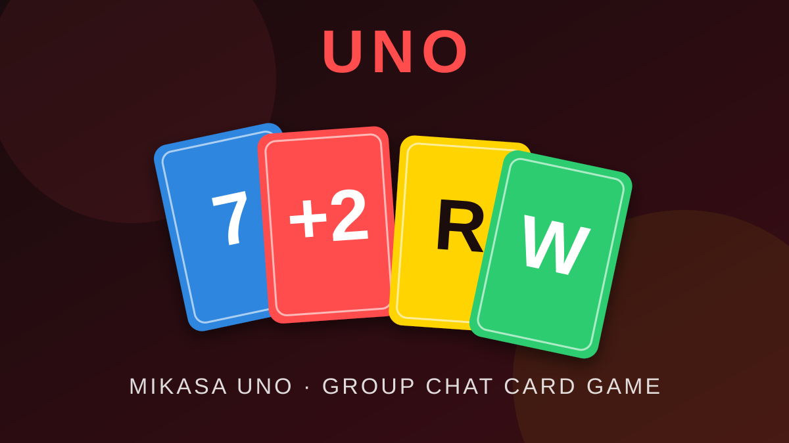

<div align="center">



**Play UNO in any Telegram group chat.**

[](https://t.me/YOUR_BOT_USERNAME)
[](https://t.me/YOUR_BOT_USERNAME?startgroup=true)


</div>

---

## About

Mikasa UNO is a Telegram bot for playing UNO with friends. Games run through inline mode, so anyone in the group can join a table and play cards without leaving the chat.

Replace `YOUR_BOT_USERNAME` in the badges above with your bot's username once you have created it.

## Features

- **Plays in group chats.** Add the bot to a group and start a table.
- **Inline play.** Type `@YourBot` to pick your cards from the chat.
- **Three game modes.** `classic`, `fast` and `wild`, set with `DEFAULT_GAMEMODE`. `/modes` explains them.
- **Stats.** `/stats` keeps each player's record.
- **Admin control.** Set `ADMIN_LIST` to let specific users manage every game.

## Setup with @BotFather

1. Send `/newbot` to [@BotFather](https://t.me/BotFather) and copy the **token**.
2. Send `/setinline` and choose a placeholder, for example `Pick a card`.
3. Send `/setinlinefeedback` and choose **Enabled** (100%).

Steps 2 and 3 are required because the game is played through inline mode. The command menu is set automatically when the bot starts.

## Deploy on Render

This folder includes a `Dockerfile` and a `render.yaml`, so the bot runs as a single Render web service.

1. Push this folder to a GitHub repository.
2. In Render, choose **New -> Blueprint** and pick the repository.
3. Fill in the secret values:
   - `TOKEN`: the bot token from @BotFather (required).
   - `DATABASE_URL`: a Postgres connection string, for example from [Neon](https://neon.tech). Without it, stats are stored on the container's disk and reset on every redeploy.
   - `ADMIN_LIST`: optional Telegram user IDs, separated by spaces or commas.
4. Deploy. When the logs show `Command menu set`, open your bot in Telegram and send `/start`.

Render's free plan sleeps after 15 minutes without traffic. The bot pings its own URL every 10 minutes to stay awake. For extra safety, add a free [UptimeRobot](https://uptimerobot.com) monitor for `https://YOUR-SERVICE.onrender.com/health` every 5 minutes.

## Run locally

Requires Python 3.14 (see `.python-version`). With [uv](https://docs.astral.sh/uv/):

```bash
uv venv --python 3.14 venv && source venv/bin/activate
uv pip install -r requirements.txt
TOKEN=123:abc python bot.py
```

Without `DATABASE_URL` the bot stores stats in a local SQLite file, `uno.sqlite3`.

## Settings

| Variable | Default | What it does |
| --- | --- | --- |
| `TOKEN` | required | Bot token from @BotFather |
| `DATABASE_URL` | none | Postgres connection string. Unset uses SQLite |
| `ADMIN_LIST` | none | Telegram user IDs (spaces or commas) who can manage every game |
| `SMALL_CAPS` | `true` | Small-caps text on or off |
| `DEFAULT_GAMEMODE` | `fast` | `classic`, `fast` or `wild` |
| `WAITING_TIME` | `120` | Seconds a player has per turn |
| `MIN_FAST_TURN_TIME` | `15` | Minimum seconds per turn in fast mode |
| `MIN_PLAYERS` | `2` | Players needed to start |
| `OPEN_LOBBY` | `true` | Whether new players can join a running game |
| `WORKERS` | `32` | Worker threads for handling updates |
| `KEEPALIVE_URL` | Render's URL | Override the URL used for the keep-alive ping |
| `KEEPALIVE_INTERVAL` | `600` | Seconds between keep-alive pings |

`config.json` (see `config.json.example`) also works for local runs. Environment variables take precedence.

## Tests

```bash
python -m unittest discover -s test -t .
```

---

<div align="center">

*Shuffle up and deal.*

</div>
